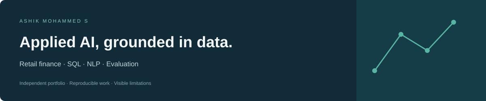

I'm **Ashik Mohammed S**, a **Senior Associate – Finance at Walgreens India GCC**,
building toward **GenAI / Applied AI Engineer** roles. My background combines
retail finance analytics, SQL, Python, cloud data pipelines and BI. I focus on
AI systems whose data, evaluation and limitations can be inspected.

[LinkedIn](https://www.linkedin.com/in/ashik-mohammed-s-348016210) ·
[Email](mailto:ashikmohammeds@outlook.com) · [Project index](PORTFOLIO.md)

## Start with these projects

| Project | What to review | Evidence and status |
| --- | --- | --- |
| **[MarginLens](https://github.com/Ashik-Mohammed-S/Marginlens)** | Retail margin drivers, contract exceptions, reconciliation and Power BI pharmacy analytics | Public synthetic retail dashboard; native Power BI report validated locally using aggregates derived from 11.96M accepted public Medicaid records. [Power BI screenshot](https://github.com/Ashik-Mohammed-S/Marginlens#power-bi-dashboard-preview). |
| **[Retail Finance Evidence Copilot](https://github.com/Ashik-Mohammed-S/Project)** | Synthetic finance ledger → read-only SQL → retrieved evidence → citations and abstention | Runnable Flask prototype, 48 authored evaluation cases, known abstention failures documented. Optional local LLM adapter; live generation quality not evaluated. |
| **[Review Compass](https://github.com/Ashik-Mohammed-S/Sentiment_Based_Product_Recommendation_System)** | Review sentiment, recommendation ranking, cold starts and a portable serving artifact | 30,000 source reviews; held-out NDCG@5 0.470 vs popularity 0.456. Flask API, browser/Python parity tests and GitHub Actions monitoring. |
| **[Complaint Product Classification](https://github.com/Ashik-Mohammed-S/Automatic_Ticket_Classifier)** | Real source labels, deduplicated text, train-only TF-IDF and imbalance-aware evaluation | Held-out macro-F1 0.464 vs majority 0.026; rare-class failures remain visible. |
| **[Healthcare Entity Extraction](https://github.com/Ashik-Mohammed-S/Identifying-Entities-in-Healthcare-Data)** | Token alignment, sentence context and disease/treatment span evaluation | Exact-span F1 0.601; research annotation task, not a clinical system. |

Review Compass has an [owner-private hosted preview](https://review-compass-ashik.swoonysnipe19.chatgpt.site).
For independent review, use its [Flask setup](https://github.com/Ashik-Mohammed-S/Sentiment_Based_Product_Recommendation_System/blob/main/APP.md).
The finance copilot is local-only in its initial release.

## MarginLens dashboard preview

[Public web dashboard](https://marginlens-retail-finance.swoonysnipe19.chatgpt.site/) · [Source and project status](https://github.com/Ashik-Mohammed-S/Marginlens) · [Power BI preview](https://github.com/Ashik-Mohammed-S/Marginlens#power-bi-dashboard-preview)

The image is a static screenshot of the native Power BI report, showing Q1–Q2 2024 public Medicaid data. Its full aggregate model covers historical snapshots from 2007, 2010, 2018 and 2024. Reimbursements are before rebates and are not pharmacy profit. The public web dashboard is a separate synthetic retail demonstration. Power BI Service publication and scheduled cloud refresh remain pending.

## Experience I bring to applied AI

- **Walgreens India GCC — Senior Associate, Finance** (October 2026–present):
  retail finance analytics and reporting continuity after transition from TCS.
- **TCS — Business Analyst, Walgreens engagement** (March 2024–October 2026):
  SQL/PySpark transformations, Snowflake/dbt pipelines, Databricks workflows,
  forecasting and BI reporting.
- **Cyient — Data Analyst** (November 2021–March 2024): SQL analysis, Python
  reporting automation and stakeholder dashboards.

Portfolio code and synthetic case studies are independent personal work. They do
not expose employer systems or establish employer endorsement.

## Technical focus

**Data and software:** Python, SQL, PySpark, Flask, SQLite, GitHub Actions.  
**Applied ML/NLP:** scikit-learn, text classification, sequence labeling,
recommendation evaluation, retrieval baselines and structured LLM output contracts.  
**Professional data stack:** Snowflake, Databricks, dbt, Power BI, DAX and Tableau.

I am extending the finance copilot with stronger independently labeled evaluation
and live local-model measurement. Planned work is tracked in its
[roadmap](https://github.com/Ashik-Mohammed-S/Project/blob/Master/ROADMAP.md), separately
from implemented capabilities. I do not claim a production GenAI deployment or
fine-tuning experience from this prototype.

## Education

Executive PG Program in Data Science, **IIIT Bangalore**.  
B.Tech in Mechanical Engineering, **Mar Baselios College of Engineering and Technology**.

Each featured repository includes the problem, dataset, method, results, run
instructions and limitations. Older academic walkthroughs are retained as reference.
